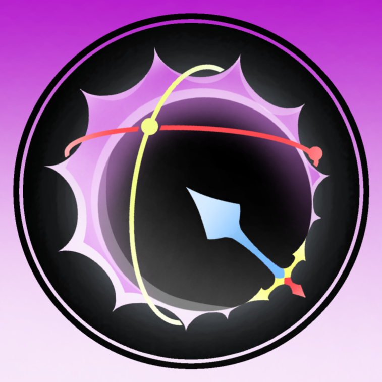

<div align="center">



# Eclipse Animator — Free Release

**A complete animation suite for Roblox Studio. Timeline, IK/FK, physics simulation, collaboration and export — in one local plugin.**

[](https://github.com/7kg2-here/Eclipse-Animator-free/releases)
[](https://github.com/7kg2-here/Eclipse-Animator-free/stargazers)
[](https://github.com/7kg2-here/Eclipse-Animator-free/commits/main)
[](https://www.roblox.com/create)
[](#license-and-disclaimer)

**[Download from Releases](https://github.com/7kg2-here/Eclipse-Animator-free/releases) — no key, no login, no payment.**

*This repository preserves the last free build of Eclipse Animator, exactly as it was before the plugin became a paid product.*

</div>

---

## Table of Contents

- [About This Repository](#about-this-repository)
- [Download in 1 Minute](#download-in-1-minute)
- [Install on Windows](#install-on-windows)
- [Install on macOS](#install-on-macos)
- [Install on Linux](#install-on-linux)
- [Verify the Install](#verify-the-install)
- [Quick Start](#quick-start)
- [Features](#features)
- [Compatibility](#compatibility)
- [Repository Contents](#repository-contents)
- [FAQ](#faq)
- [Troubleshooting](#troubleshooting)
- [Contributing](#contributing)
- [License and Disclaimer](#license-and-disclaimer)

---

## About This Repository

Eclipse Animator is a full animation and rigging plugin for Roblox Studio. It was built as an alternative to limited timeline plugins on one side, and heavy external 3D software on the other.

This repository contains the **pre-paid build**:

- One `.rbxmx` plugin file, ready to install.
- No license server.
- No account checks.
- No key system.
- Works offline inside Roblox Studio once installed.

Later development of Eclipse Animator continued as a paid product. That newer work is **not** included here. This repo is frozen at the last free state, kept available for the animation community.

Author of the plugin code: `riftkuro` (see file header inside the `.rbxmx`).

---

## Download in 1 Minute

For anyone who just wants the file:

1. Open the Releases page:
   **https://github.com/7kg2-here/Eclipse-Animator-free/releases**
2. Open the latest release (for example `v1.0957-free`).
3. Under **Assets**, download the file:
   `Eclipse-Animator-inspect.rbxmx`
4. Follow the install steps for your system below.

Direct links:

- All releases: https://github.com/7kg2-here/Eclipse-Animator-free/releases
- Repository files: https://github.com/7kg2-here/Eclipse-Animator-free

If you downloaded the repo as ZIP instead, unzip it first and use the same `.rbxmx` file inside.

---

## Install on Windows

Recommended method: local Plugins folder.

1. Download `Eclipse-Animator-inspect.rbxmx` from Releases.
2. Press `Win + R`, type:
   ```
   %LOCALAPPDATA%\Roblox\Plugins
   ```
   Press Enter. Create the `Plugins` folder if it does not exist.
3. Copy the `.rbxmx` file into that folder.
4. Close Roblox Studio completely if it is open, then open it again.
5. Open any place, go to the **Plugins** tab in the top ribbon. Eclipse Animator should appear there.

Alternative method: Insert from File.

1. Open Roblox Studio with any place.
2. Right-click **Workspace** or **ServerStorage** in Explorer.
3. Choose **Insert from File**, select the `.rbxmx`.
4. Right-click the inserted object, choose **Save as Local Plugin**.
5. Restart Studio.

---

## Install on macOS

1. Download `Eclipse-Animator-inspect.rbxmx` from Releases.
2. Open Finder, go to:
   ```
   ~/Documents/Roblox/Plugins
   ```
   If the `Plugins` folder does not exist, create it:
   `Documents / Roblox / Plugins`
3. Copy the `.rbxmx` file into that folder.
4. Quit Roblox Studio completely (`Cmd + Q`), then open it again.
5. Open any place, go to the **Plugins** tab. Eclipse Animator should appear there.

If macOS blocks the file because it came from the internet:

1. Right-click the file in Finder, choose **Open**. Or go to **System Settings / Privacy and Security** and allow it.
2. Restart Studio once more.

---

## Install on Linux

Roblox Studio has **no official native Linux build**. The plugin itself is the same file, but you first need a working Studio installation. Two practical options:

**Option A — Vinegar / Bottles with Wine (community workaround)**

1. Install Roblox Studio through [Vinegar](https://vinegarhq.org/) or Bottles with Wine. Follow that project's own install guide for your distro.
2. Download `Eclipse-Animator-inspect.rbxmx` from the Releases page.
3. Locate the Wine prefix Studio uses for plugins. This varies by setup, typically something like:
   ```
   ~/.local/share/vinegar/prefixes/studio/drive_c/users/<you>/AppData/Local/Roblox/Plugins
   ```
   Check Vinegar / Bottles documentation for the exact path on your version.
4. Copy the `.rbxmx` into that `Plugins` folder.
5. Restart Studio through Vinegar / Bottles.

**Option B — Windows virtual machine**

1. Run Windows in VirtualBox, VMware, or QEMU/KVM.
2. Inside Windows, follow the [Windows install steps](#install-on-windows).

Stability on Linux depends on Wine and your distro. If animation playback is unstable there, use Windows or macOS for production work.

---

## Verify the Install

1. Open Roblox Studio.
2. Open any Baseplate or existing place.
3. Click the **Plugins** tab.
4. Click **Eclipse Animator**.
5. The main window with timeline should open.

If the button is missing, see [Troubleshooting](#troubleshooting).

---

## Quick Start

1. Insert a rig into Workspace: R6, R15, or a custom rig.
2. Open Eclipse Animator from the Plugins tab.
3. Select your rig in the plugin window to bind it.
4. Create a new animation and name it.
5. Pose the rig in the viewport, move the playhead, set a keyframe (`K` by default).
6. Repeat to build the sequence.
7. Adjust easing in the graph / curve editor.
8. Preview in the viewport or picture-in-picture camera.
9. Export the animation for your game, or use the ModuleScript exporter for scripted playback.

---

## Features

### Timeline and Keyframes

- Frame-accurate scrubbing and multi-track layers.
- Move, scale, mirror, and retime selections in bulk.
- Copy and paste across tracks.
- Pose library for storing and reusing poses.

### Easing and Curves

- Bezier and multi-mode easing per keyframe.
- Graph editor for ease-in, ease-out, overshoot, and snap control.

### Rigging

- Toggleable IK and FK. Lock hands, feet, or head in space, then switch back mid-timeline.
- R6, R15, custom skeletons, and Blender-imported rigs.
- Dynamic parenting: keyframe a weapon to follow a hand, then detach it later.
- Character and prop animation in the same scene.

### Physics

- Viewport physics simulation for throws, ragdolls, impacts, and props.
- Mix hand-authored keys with simulated motion.
- Preview without leaving the editor.

### Collaboration

- Live editing in Team Create sessions.
- Shared review and handoff without passing files back and forth.

### Reliability

- Background timeline snapshots for crash recovery.
- Picture-in-picture camera preview.
- Built-in pose and audio library.
- Grease-pencil viewport sketching for planning.
- Fully remappable keybinds and dockable layout.

### Export

- Animation export for in-game use.
- ModuleScript exporter for scriptable, reusable motion.
- Support for unparented effects, props, and non-standard hierarchies.

### Cinematics

- Camera shake presets.
- Impact frames for combat readability.
- Cutscene framing helpers.

Default shortcuts:

| Action | Default |
| :--- | :--- |
| Play / Pause | `Space` |
| Next frame | `Right Arrow` |
| Previous frame | `Left Arrow` |
| Set keyframe | `K` |
| Delete keyframe | `Delete` |
| IK / FK, Simulate, Camera preview | Configurable in plugin settings |

Confirm bindings in the plugin settings panel, as they can be remapped.

---

## Compatibility

| Requirement | Details |
| :--- | :--- |
| Roblox Studio | Current release channel recommended |
| Windows | 10 / 11, 64-bit, supported |
| macOS | Current Studio-supported versions, supported |
| Linux | No native Studio build. Community workaround via Wine / Vinegar / Bottles only |
| Rigs | R6, R15, custom rigs, Blender-imported rigs |
| Team Create | Supported |
| Internet | Only needed to download the file. The plugin runs locally after install |
| Dependencies | None |

---

## Repository Contents

```
.
├── assets/
│   ├── logo-official-1024.png            # Official logo (Discord server icon, used in README)
│   ├── logo.png                        # Same official logo
│   ├── logo-plugin.png                 # Original in-plugin header icon (transparent)
│   ├── logo-crescent.png               # Original toolbar brand mark
│   └── logo-concept.svg                # Alternative concept art
├── Eclipse-Animator-inspect.rbxmx      # The plugin file. Install this.
├── README.md                           # This documentation
├── LICENSE                            # Usage terms
├── CONTRIBUTING.md                     # How to report bugs and propose changes
└── .github/
    ├── ISSUE_TEMPLATE/
    │   ├── bug_report.yml
    │   └── feature_request.yml
    ├── PULL_REQUEST_TEMPLATE.md
    └── workflows/
        └── validate.yml
```

File size note: the `.rbxmx` is about 11 MB and contains the full plugin source in Luau.

---

## FAQ

**Is this the latest Eclipse Animator?**

No. This is the last free build before the paid transition. It is preserved as-is.

**Does it need a key or payment?**

No. No key, no login, no activation.

**Can I use it for my game, videos, and commissions?**

Yes, for your own projects. See [License](#license-and-disclaimer). You may not resell the plugin itself or put it behind a paywall.

**Does it work with custom rigs?**

Yes. R6, R15, custom skeletons, and Blender-imported rigs are supported.

**Does it work in Team Create?**

Yes. Live collaboration is supported.

**Is it safe?**

It installs as a local Studio plugin. To inspect it first, use Insert from File instead of copying it directly to the Plugins folder, then browse its contents in Explorer before saving it as a plugin.

**What if Studio crashes?**

The plugin keeps background snapshots and can restore the timeline session.

---

## Troubleshooting

| Problem | Fix |
| :--- | :--- |
| Plugin missing from Plugins tab | Confirm the `.rbxmx` is in the correct Plugins folder for your OS. Restart Studio completely. |
| Button shows but window is blank | Update Studio to the latest release. Relaunch. Disable conflicting animation plugins and retry. |
| Choppy preview | Simplify the scene during preview. Close heavy viewport panels. |
| Keys look wrong after retiming | Open the graph editor, check easing curves, re-scrub the timeline. |
| Physics behaves unexpectedly | Check rig collision and mass properties. Re-run simulation from a clean state. |
| Team Create does not sync | Confirm all users are in the same session with a stable connection. |
| Layout looks broken | Reset the interface layout in plugin settings, then re-dock panels. |
| macOS quarantine warning | Allow the file in Privacy and Security, then restart Studio. |
| Linux / Wine issues | Verify your Vinegar / Bottles prefix path. Update Wine. Use Windows or macOS for critical work. |

If the problem persists, open an issue with: Studio version, OS and version, plugin file name and release tag, and exact reproduction steps.

---

## Contributing

Bug reports and documentation fixes are welcome. This is an archive of a past release, so no new plugin features are planned here.

- Found a bug in this free build: open an issue with Studio version, OS, steps to reproduce, and expected behavior.
- Have a docs improvement: open a pull request against `README.md` or `CONTRIBUTING.md`.
- Please do not repackage and resell this build.

See `CONTRIBUTING.md` for the full guide.

---

## License and Disclaimer

This build is shared for free community use, in the state it existed before Eclipse Animator became paid.

You may:

- Install and use it in personal, educational, and commercial projects.
- Share this repository link with others.

You may not:

- Resell the plugin file itself.
- Redistribute it behind a paywall, key system, or paid pack.

The plugin is provided **as is**, without warranty of any kind. Keep backups of your places and animation files. The maintainers of this archive are not responsible for data loss or project issues arising from its use.

This archive is not affiliated with or supported by any current paid distribution of the plugin.

---

<div align="center">

**Eclipse Animator — free build, preserved for animators.**

Roblox Studio animation, timeline editing, IK and FK rigging, physics simulation, Team Create collaboration, and animation export.

*Keywords: roblox animation plugin, roblox studio animator, r6 r15 animation, ik fk rig, animation timeline, luau animation, free animator, eclipse animator.*

</div>
